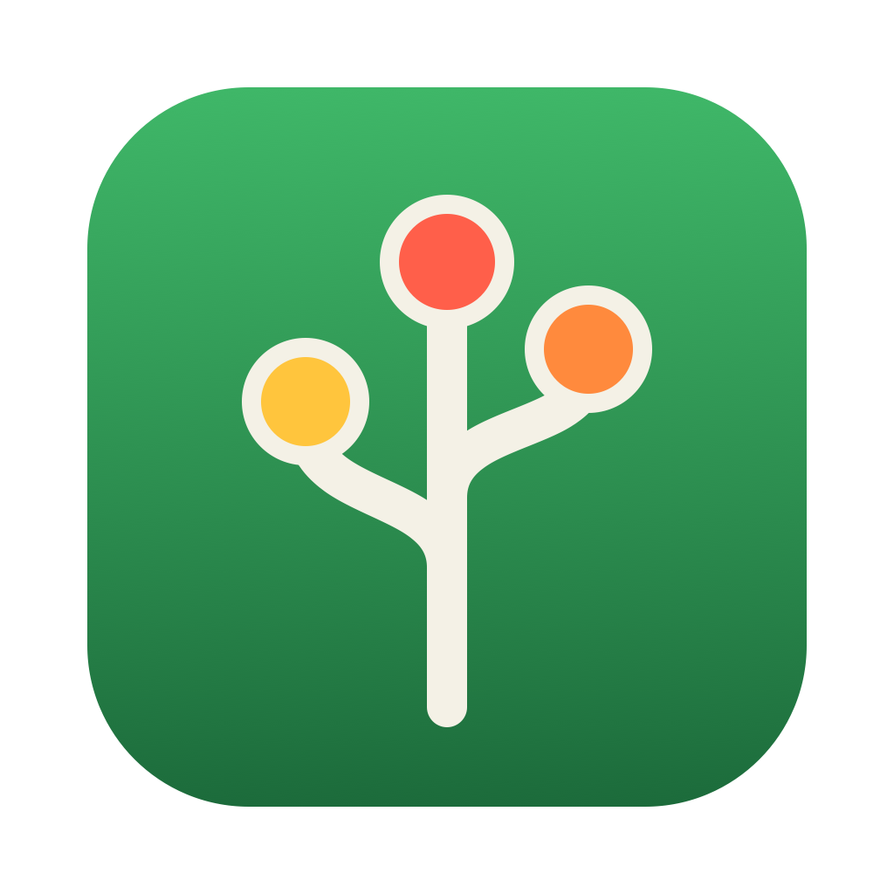

<p align="center"></p>

# Orchard

Orchard is a minimal Electron app that runs several Claude Code processes and streams their replies to a chat UI.

## Getting started

```bash
npm install
npm start
```

Requires `claude` on your PATH and a logged-in session (run `claude` once in a terminal).

## Workspaces, agents and worktrees

A workspace is a git repo on your machine. Add one with "+" next to "Workspaces" in the sidebar;
the list is saved in `workspaces.json` in the app's user data folder.

"+ Create" (or "+" on a workspace) opens the create view: pick a workspace, model and effort,
describe the task and press Enter (Shift+Enter for a new line). The app runs
`git worktree add -b orchard/<slug> <repo>-orchard/<slug>`, where the slug comes from the first
line of the prompt (a taken slug gets `-2`, `-3`, …), starts claude there and sends the prompt as
the first message. Model and effort are passed as `--model`/`--effort`; "Default" leaves them out.

Claude runs with `--permission-mode auto`, like the Claude Code app: a classifier approves safe
actions. What still needs approval, and questions from `AskUserQuestion`, show up as cards in the
chat; the agent waits until you answer there.

"×" on an agent stops it and runs `git worktree remove` (without `--force`). If the worktree has
uncommitted changes, git refuses and the worktree stays. The `orchard/<slug>` branch is always kept.
Worktrees are not removed when the app quits, and agents are not restored on the next start.

## Settings

"Settings" at the bottom of the sidebar shows which Claude Code the app uses: version, provider,
login method, organization and email, read from `claude --version` and `claude auth status`.
"Refresh" reads them again. If you are not logged in, run `claude auth login` in a terminal.

You can point the app to a specific Claude Code executable (absolute path, must be executable).
It is saved in `settings.json` in the app's user data folder and applies to agents created after
the change. "Use system Claude Code" goes back to `claude` from your PATH.

## Structure

- `agent.js` – `createWorktree`/`removeWorktree`/`repoRoot`, `claudeStatus`/`checkExecutable`, the model/effort allowlists and an `Agent` = one `claude -p --input-format stream-json --output-format stream-json --verbose` process. Reads JSON lines from stdout, writes JSON lines to stdin. No Electron dependency, testable on its own (`npm test`).
- `main.js` – Electron main process. Keeps the workspace list and the agents, starts them, forwards events to the UI over IPC, shows a desktop notification when an agent finishes and stops all processes on quit.
- `preload.js` – thin bridge (`window.agents`) between the UI and the main process.
- `renderer/` – sidebar (workspaces with their agents), create, chat and settings views.

## Next steps

1. Permission prompts as buttons (needs the Agent SDK or `--permission-prompt-tool`).
2. Diff view per agent.
3. Persist sessions (`sessionId` already exists on `Agent`) and resume with `--resume`.
